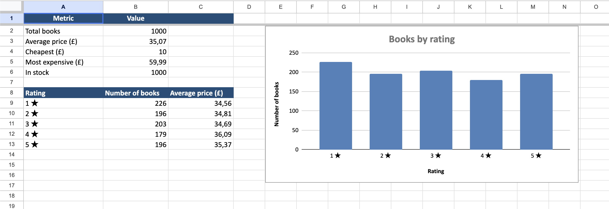

# Book Scraper → Excel Report



A Python script that collects all 1,000 books from [books.toscrape.com](https://books.toscrape.com) (a website built for scraping practice) and turns them into a clean, ready-to-use Excel report.

## What it does

- Goes through **all 50 pages** automatically (follows the "next" button)
- Extracts **title, price, star rating, availability and link** for every book
- Saves everything to a **formatted Excel file**:
  - **Books** sheet – styled header, filters on every column, frozen header row, clickable links
  - **Summary** sheet – total books, average / min / max price, stock count, books per rating + a **bar chart**
- Waits briefly between requests so the website isn't overloaded

## Tech

Python 3 · requests · BeautifulSoup · openpyxl

## How to run

```bash
pip install -r requirements.txt
python scraper.py                    # all pages -> books.xlsx
python scraper.py --pages 3          # quick test, first 3 pages
python scraper.py --output report.xlsx
```

## Use cases for clients

The same approach works for collecting product prices from e-shops, building lead lists from directories, monitoring competitors or gathering any public data into Excel / CSV / Google Sheets.

---
Author: Diana ([@didistark](https://www.freelancer.com/u/didistark))
